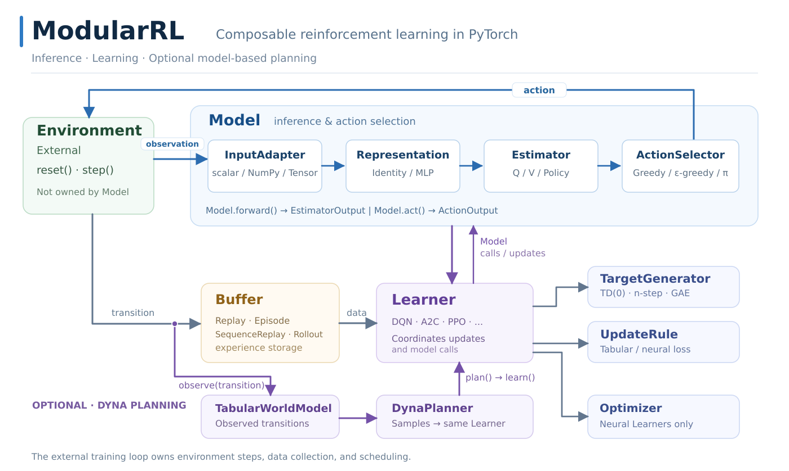

# ModularRL

An educational and research reinforcement learning library built from interchangeable PyTorch components.
Supports tabular DP/MC/TD control, DQN/Double DQN, Dyna, Actor-Critic, A2C and PPO with GAE.



Install from this checkout: `python -m pip install .`

```python
from modular_rl import Model, representations as R, estimators as E, selectors as S
from modular_rl import learners as L, targets as T, updates as U
from modular_rl.data import Transition

model = Model(R.Identity(), E.TabularQ(16, 4), S.EpsilonGreedy(.1))
learner = L.QLearning(model, T.TD0(.99), U.TabularQ(.5))
learner.learn(Transition(0, 1, 1.0, 1, False, False).to_batch())
```

[API](docs/API.md) · [Architecture](docs/ARCHITECTURE.md) · [Tutorials](docs/GYMNASIUM_TUTORIALS.md)
[MIT License](LICENSE) · Copyright (c) 2026 Jinuk Huh
