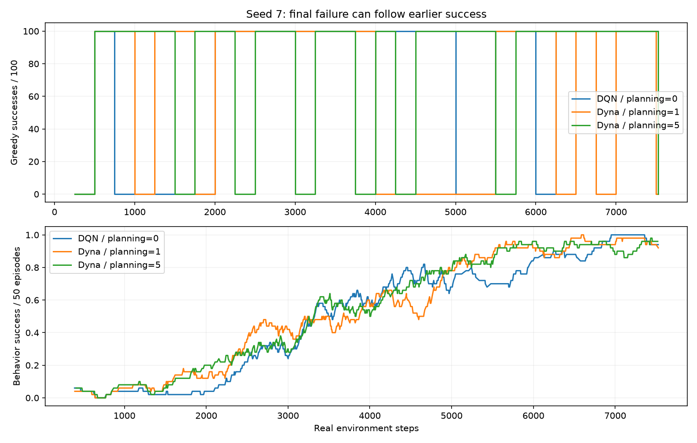
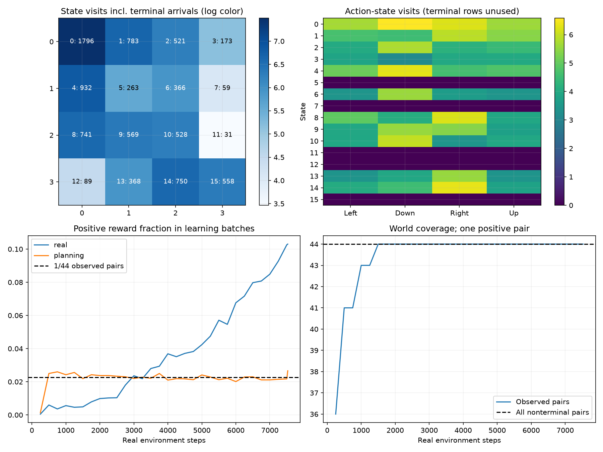
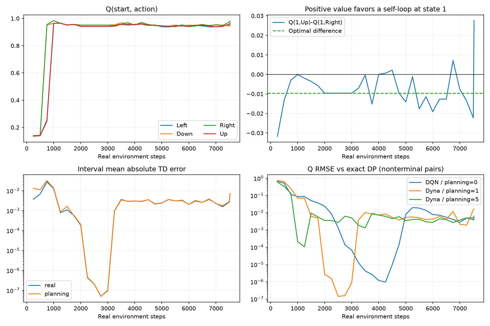
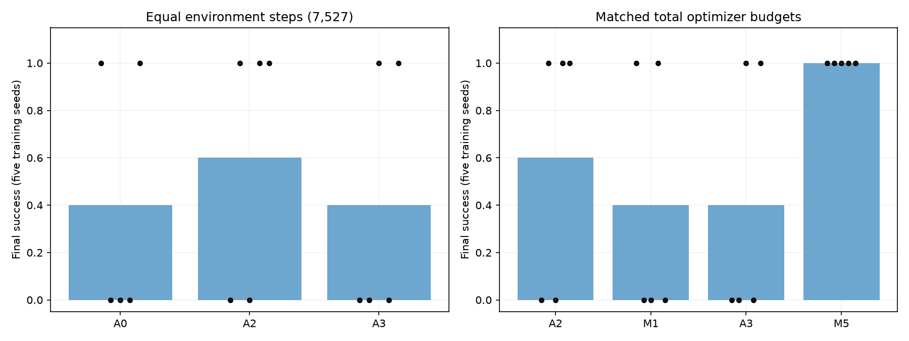
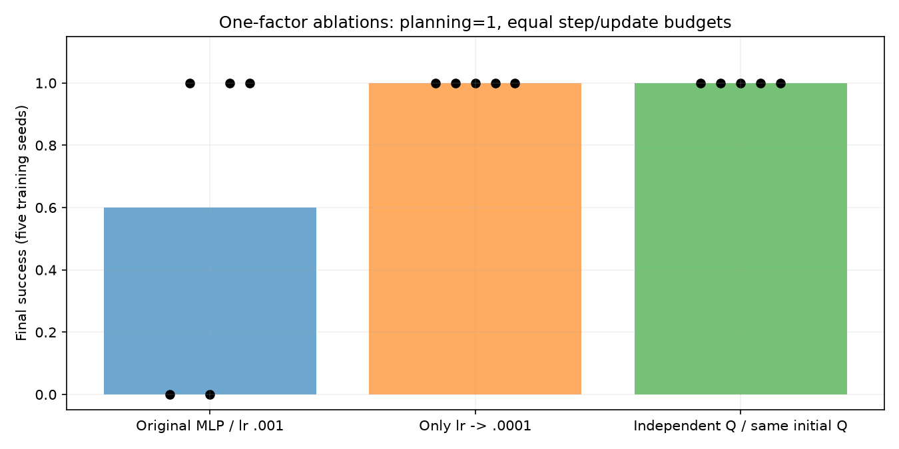

# FrozenLake Dyna-DQN 진단

기준 구현은 `554e576`이다. 총 46개의 실제 FrozenLake 학습 실행과 작은 MDP 전파 실험을 기록했다. 목표는 최종 Greedy 0/100의 원인을 설명하는 것이며, 좋은 설정만
고르는 성능 탐색이 아니다. Notebook과 라이브러리 계산은 변경하지 않았다. 아래의 수치는 실제로
실행한 실험이며 원시 로그에서 생성한 [결과 자료](../experiments/results/dyna_dqn_diagnosis_summary.json)에
설정, 방문 분포, Q, 샘플 수, 정확한 학습 상태/RNG 해시와 원시 JSON 해시를 함께 보존한다.

## 1. 실제 기준 설정

|항목|FrozenLake Notebook 14 FULL|
|---|---|
|환경|Gymnasium FrozenLake-v1, 4×4 `SFFF/FHFH/FFFH/HFFG`, is_slippery=False|
|상태/행동|정수 상태 0–15, 행동 Left=0/Down=1/Right=2/Up=3; 시작 상태 0|
|관측 인코딩|동결 identity Embedding(16,16), 원시 정수 ID를 Replay/World에 저장|
|Online/Target|One-hot → Linear(16,64) → ReLU → Linear(64,64) → ReLU → Linear(64,4)|
|초기 Q (Seed 7, 상태 0)|[-0.0096399076, 0.1389717758, 0.0054881722, 0.0701250583]|
|전체 상태 초기 Q 범위|[-0.0511294976, 0.1544600129]; 전체 배열은 결과 JSON에 보존|
|dtype/device|float32 / CPU, Torch thread=1|
|gamma|0.99|
|Optimizer/Loss|단일 Adam(lr=0.001), SmoothL1Loss(reduction='none') 후 평균|
|epsilon|max(0.05, 1 - 이전 환경 step/6000), Step마다 갱신|
|Replay|capacity=5000, 균등 비복원 추출, 독립 NumPy RNG seed=학습 seed|
|Warm-up/Batch|64 / 32|
|Real train frequency / gradient steps|실제 Step마다 1회 / 1회|
|Planning|매 Step observe 후 1회; B=32, 관측 pair 균등 복원 추출, RNG seed=학습 seed+3|
|World Model|관측한 (state,action)의 최신 결정적 전이; 미관측 pair를 예측하지 않음|
|Target sync|초기 명시적 복사 + 실제 환경 100 Step마다; Planning은 Sync하지 않음|
|종료/Truncation|환경 TimeLimit=1000; terminated만 Bootstrap 중단, 두 flag에서 Episode 종료|
|원래 예산|1000 Episode. Seed 7에서는 실제 7527 Step, 7464 Real + 7527 Planning 학습|
|평가|별도 동일 맵/비미끄럼 환경, TimeLimit=100, 순수 Greedy(argmax 동률 최소 ID)|
|평가 seed|학습 seed+1000+i, i=0…99|

이 환경에서 고정 Greedy 정책과 시작 상태는 결정적이다. 따라서 100 Episode는 같은 경로를
반복하는 재현성 검사이고, 100개의 독립적인 학습 Seed가 아니다. Seed별 통계의 단위는
학습 Seed 7/11/19/23/42의 다섯 실행이다.

`examples/gridworld_dyna_dqn.py`는 **DLFS4 3×4, 11개 유효 상태**의 다른 실험이다.
기본 gamma=.9, MLP(128,128), lr=.0001, Replay=10000, Sync=250, 실제 3000 Step이며
FrozenLake의 실패 결과와 섞지 않는다. Notebook 13은 Tabular Q이고, Notebook 15는 CartPole
MLP(128,128) DQN이다. 이들의 학습 성능을 FrozenLake DQN의 대조군으로 대신 사용하지 않았다.

## 2. 재현과 통제 방법

- 원래 1000 Episode를 먼저 재현했다. Seed 7의 7527 Step/1000 Episode/558 Goal/Greedy 0/100과
  최종 batched Q가 앞선 FULL 원자료와 비트 단위로 같았다. 전체 Online 가중치와
  Torch/Replay/Planning RNG도 이전 Notebook 실행과 정확히 일치했다.
- 이후 A0/A1/A2/A3는 모두 7527 환경 Step을 사용한다. Seed 7의 고정 Step A2도 원래 Episode
  실행과 Parameter·Target·Optimizer·실제 궤적·Torch/Replay/Planning/환경 RNG 해시가 같다.
- A0는 기본 DQN, A1은 World 수집만 하는 Planning=0, A2는 Planning=1, A3는 Planning=5다.
  A0와 A1은 World 수집 외의 모든 동작이 같아야 한다.
- 모든 설정을 고정하고 Seed만 바꿨다. 환경 Step이 같아도 행동/경험과 Episode 수는 달라진다.
  마지막 열린 Episode는 부분 Episode로 보고하고 실제 환경 flag를 조작하지 않는다.
- 진단은 Real/Planning 학습 뒤, 그 Step의 예정된 Target Sync **직전**에 250 Step마다 기록한다.
  따라서 interval 경계에서의 Online–Target 차이가 Sync로 0이 되어 가려지지 않는다.
- 평가 정책은 `Model.act(s, deterministic=True)`와 같은 **scalar forward**로 얻는다. Batched GEMM의
  미세한 반올림이 거의 동률인 행동을 바꾸는 문제를 피했다. 최종 실패의 행동 차이는
  약 0.02757로 이 수준보다 훨씬 크며, 실제 Model.act와 일치해 평가 캐시 오류로 설명되지 않는다. 캐시 정책과 실제 Model.act의 일치도 테스트했다.
- TD 평균은 signed mean, 크기는 mean(|delta|)/max(|delta|)로 정의한다. Loss는 미니배치 평균이다.
  Q 최대치는 전체 상태와 비종료 상태를 구분한다. Terminal 행의 Neural Q는 추가 학습 대상이 아니므로
  임의의 Terminal Q를 가치 발산의 증거로 사용하지 않는다.

## 3. 계측 무간섭성과 정확성 검사

`tests/test_dyna_dqn_diagnosis.py`의 결정적 검사는 다음을 확인한다.

- 계측 on/off에서 Parameter·Target·Optimizer·궤적·Torch/Replay/Planning/환경 RNG 동일
- A0/A1 학습 동일, 독립적인 Notebook 순서 구현과 진단 실행의 동일성
- 실제/synthetic Bellman Target, 자연 종료와 truncated-only, 추가 env.step 없는 Planning
- 정확한 Optimizer 예산 배분, Target Sync는 환경 Step 기준
- 독립 Q ablation의 모든 초기 Q와 행동 RNG 일치
- 작은 MDP의 Tabular/Neural 보상 역전파

World의 snapshot·저장/복원·pair 순서·빈 모델·RNG 독립성과 Real/Planning의 동일 Optimizer 공유,
자동 Sync 부재는 기존 Dyna/DQN/Planning 회귀 테스트에서도 함께 검사한다.
알려진 FrozenLake P와 DP는 진단용 참조 계산에만 쓰고 World나 Learner에 전달하지 않는다.

## 4. 동일 환경 Step 비교

|설정|7|11|19|23|42|평균 / 성공 Seed|Real|Planning|총 학습|
|---|---:|---:|---:|---:|---:|---|---:|---:|---:|
|A0 DQN|100|0|0|0|100|40% (2/5)|7464|0|7464|
|A1 World만 수집|100|0|0|0|100|40% (2/5)|7464|0|7464|
|A2 Planning=1|0|100|0|100|100|60% (3/5)|7464|7527|14991|
|A3 Planning=5|0|0|100|0|100|40% (2/5)|7464|37635|45099|

추가 A4는 Seed 7에서 Planning=20만 바꿨다. 실제 Step은 7527, Real=7464,
Planning=150540, 총 Optimizer=158004, Goal=591, 최종 평가는 100/100이었다.
P=1/5의 실패와 P=20의 성공은 이 Seed에서 비단조적인 결과다. 업데이트 비용이 크게 다르고
다른 Seed나 동일 Optimizer P=20 통제군은 실행하지 않았으므로 일반적인 권장값으로 삼지 않는다.

A0와 A1의 정확한 학습 상태/궤적/RNG 해시는 다섯 Seed 모두 같다. World.observe가 학습을
바꾼다는 증거는 없다. Planning은 추가 Gradient Update와 다른 표본 분포를 동시에 도입하므로
이 표만으로 가상 경험 자체의 인과 효과를 단정하지 않는다.



## 5. 실제 경험과 World Model의 질

Seed 7 A2의 첫 Goal은 Step 239다. 학습 중 558회 성공했고, Replay의 최종 5000개 중 516개가
양의 보상 전이다. 비종료 상태의 모든 44개 pair를 실제로 관측했고 World의 44개 예측은 모두
환경의 결정적 전이와 일치했다. 양의 보상 pair는 `(14, Right)` 하나다.

- Real 미니배치: 238848개 표본 중 양의 보상 8996개(3.7664%).
- Planning 미니배치: 240864개 표본 중 양의 보상 5318개(2.2079%).
- 44개 pair의 균등 샘플링에서 양의 pair 비율은 1/44≈2.2727%다. 초기 미관측 기간을 포함한
  실제 비율은 이에 근접한다. 표본이 적어 성공 전이가 거의 재사용되지 않았다는 상황은 아니다.
- A3는 Goal 608회, Planning에서 양의 보상 27456개를 학습하고도 최종 Greedy가 실패했다.

Case B1(성공 미발견)은 Seed 7의 최종 실패 설명이 아니다. B2(성공 전이 유실)도 관찰되지 않았다.
B3는 Real보다 낮은 성공 표본 비율이라는 **분포 차이**로 남지만, 성공 재사용이 거의 없었던 것은 아니다.
B4는 가치가 한 번도 전파되지 않은 경우가 아니라 **전파 후 다시 행동 순위가 흔들리는 경우**다.
모든 Seed/설정의 방문·보상·Coverage·표본 수는 결과 JSON에 보존한다.



## 6. 실패를 직접 만드는 Q와 정책

Seed 7 A2의 최종 실제 Greedy 경로는 `0 → 1 → 1 → …`이며 평가 TimeLimit에 걸린다.
상태 1에서 Up은 윗벽에 막혀 상태 1에 머문다.

|상태 1의 행동|추정 Q|DP 최적 Q*|
|---|---:|---:|
|Left|0.95746070|0.94148015|
|Down (Hole)|0.00734095|0|
|Right|0.96092469|0.96059601|
|Up (self-loop)|0.98849440|0.95099005|

올바른 Right/Up 차이는 약 0.009606인데 Up의 오차는 +0.037504다.
실제 추정에서는 Up이 Right보다 약 0.027570 높아 Greedy가 self-loop를 고른다.
A3는 시작 상태 0의 Left self-loop를 고른다. NaN/Inf나 큰 수치 폭주가 없어도 이러한
작은 절댓값 오차는 행동 순위를 뒤집어 Return 0을 만든다.

A2는 Step 2000–3000 부근에 DP의 Q*에 매우 가까워지고 Greedy 평가에도 성공했다.
이후 다시 0/100과 100/100을 오간다. 따라서 초기 보상의 신용할당이 구조적으로 불가능하거나,
현재 MLP가 정답을 표현하지 못한다고 단정할 근거는 없다. 최종 체크포인트만 보면 이 과정을 놓친다.

전체 학습의 mean(|TD error|)는 Real 0.003447 / Planning 0.004116이다. 이 평균과 작은 Loss만으로
0.01 안팎인 행동 간격의 보존을 보장할 수는 없다. 아래 그림은 비종료 Q만을 DP와 비교한다.



## 7. 동일 총 Optimizer Step 비교

D2는 Replay-only DQN의 업데이트 수를 A2/A3와 정확히 맞춘다.
7527 환경 Step에서 Replay 학습 가능 Step은 7464다. 목표 총량은 M1=14991, M5=45099다.
Replay 가능 Step j에서 누적 할당량을 `floor(j * 목표총량 / 7464)`로 두어 정수 차이만큼 학습한다.
그 결과 주로 2/3회 또는 6/7회 업데이트하고 전체 총량은 정확히 일치한다. Target Sync는 계속
환경 100 Step마다다. 초반 Replay Warm-up 동안 불가능했던 업데이트의 **시점**까지 맞춘 것은 아니다.
표본 분포, 수집 궤적과 초기 학습 시점은 Dyna와 다르므로 데이터 출처만의 완전한 인과 분리는 아니다.

|설정|7|11|19|23|42|평균 / 성공 Seed|Real|Planning|총 학습|
|---|---:|---:|---:|---:|---:|---|---:|---:|---:|
|A2 Dyna P=1|0|100|0|100|100|60% (3/5)|7464|7527|14991|
|M1 Replay 총량 일치|100|0|0|100|0|40% (2/5)|14991|0|14991|
|A3 Dyna P=5|0|0|100|0|100|40% (2/5)|7464|37635|45099|
|M5 Replay 총량 일치|100|100|100|100|100|100% (5/5)|45099|0|45099|

M1은 2/5, M5는 5/5 Seed에서 최종 성공했다. 같은 업데이트 총량에서도 A2/M1과 A3/M5는
다른 결과를 냈다. 특히 M5의 5/5와 A3의 2/5는 이 실행에서 Planning=5를 단순한 더 많은 학습으로
설명할 수 없음을 보여 준다. 다만 표본 출처·방문 궤적·Warm-up 시점이 함께 달라 순수한 분포 효과를
유일 원인으로 확정하지 않는다. P=1과 P=5에서 방향이 일관되지 않아 Planning 일반론으로 확대하지 않는다.



## 8. 작은 결정적 MDP로 가치 전파 분리

`S0 --a0, r=0--> S1 --a0, r=1, terminated--> S2`를 사용했다. 행동은 하나이며
두 실제 전이를 World에 미리 관측시켜 탐색을 완전히 제거했다. gamma=.9다.
Terminal Q를 의도적으로 50으로 두어도 종료 전이에는 Bootstrap하지 않아야 한다.

Tabular Q-learning(alpha=.3)과 Neural DQN(독립 One-hot Linear, SGD=.1, MSE)은
각각 320회 Planning 후 `[Q(S0),Q(S1)]≈[.9,1.]`에 도달했다.
DQN Target은 실험자가 4회 업데이트 블록마다 **명시적으로** Sync했다. Planner 자체는 Sync나
환경 Step을 만들지 않았다. 이 보상 전파 시험은 FrozenLake의 탐색/최적화 문제와 계산 오류를 분리한다.
학습률·Optimizer가 다르므로 Tabular와 Neural의 표본별 갱신 동등성을 주장하지 않는다.

## 9. 원인 확인 후 한 변수씩 바꾼 ablation

원래 기준/방문/Q 진단을 확인한 뒤 수행했다. 보상은 모든 실행에서 원래 FrozenLake의 0/1이다.

|설정|7|11|19|23|42|평균 / 성공 Seed|Real|Planning|총 학습|
|---|---:|---:|---:|---:|---:|---|---:|---:|---:|
|기준 MLP lr=.001|0|100|0|100|100|60% (3/5)|7464|7527|14991|
|lr만 .0001|100|100|100|100|100|100% (5/5)|7464|7527|14991|
|독립 Q Parameterization|100|100|100|100|100|100% (5/5)|7464|7527|14991|

Seed 7에서 추가로 한 변수씩 바꾼 탐색적 실험:

|변경|평가|환경 Step|총 업데이트|
|---|---:|---:|---:|
|Sync 100→25|100/100|7527|14991|
|Sync 100→500|100/100|7527|14991|
|Planning 시작 1→64|0/100|7527|14928|
|환경 예산 7527→15054|100/100|15054|30045|


독립 Q는 One-hot → bias 없는 Linear(16,4)다. 원래 MLP의 **모든 초기 Q**를 복사하고,
MLP 초기화 직후 Torch RNG도 복원했다. 초기 가치/행동 RNG를 바꾸지 않고 Parameterization을
분리했다. 다만 Parameterization은 Gradient 공유뿐 아니라 최적화 조건도 바꾸므로
'공유 Representation 하나만이 유일한 원인'이라는 증명은 아니다.

학습률 ablation은 lr만 0.001→0.0001로 바꾸고 Real/Planning 수, Sync, Replay와 Network는
동일하게 유지했다. 단일 Seed의 Sync 변경이나 더 긴 학습이 성공하더라도 일반적 개선으로
단정하지 않는다. 실패한 Warm-up ablation도 함께 기록한다.



## 10. 결론의 강도와 권장안

**확정:** 실패한 최종 Greedy 정책은 벽 self-loop/잘못된 행동 순위를 갖는다. 성공 경험은
충분히 발생하고 World에 올바르게 보존·재사용된다. 기본 DQN에서도 실패하며, 계측과
World-only 수집이 학습 상태를 바꾸지는 않는다. 결정적 Target/종료/공유 Optimizer/Sync 시험은 통과했다.

**유력:** 이 설정의 높은 고정 학습률과 함수근사·Bootstrap·비균등/균등 표본 혼합에서 생기는
유한한 Q 변동이 작은 행동 간격을 넘어선다. '학습 자체가 전혀 안 됨'보다는 **최종 정책 안정성** 문제다.
lr 감소와 독립 Parameterization의 다중 Seed 결과가 이를 지지한다.

**미확인:** Optimizer의 적응 통계, Gradient 간섭, Target 지연, 표본 분포 각각의 기여도를
완전히 분리하지 못했다. 모든 MDP/Seed에 구현 버그가 없다는 형식적 증명도 아니다.
Planning이 본질적으로 유해하거나, 다섯 Seed로 한 설정의 보편적인 우월성이 입증됐다고 주장하지 않는다.

권장안은 먼저 이 FrozenLake 실험에서 lr=.0001을 명시적 후속 설정으로 사용하고,
중간 Greedy 성능·행동 간격·비종료 Q 오차를 계속 관측하는 것이다. lr 변경을 라이브러리의
새 기본값으로 적용하지 않았다. 기존 Dyna-Q/Dyna-DQN API와 수식은 유지할 수 있다.
좋았던 체크포인트만 골라 원래 0/100을 지우거나 Reward Shaping으로 기준 문제를 바꾸지 않았다.
A2C/GAE/PPO/Neural World Model/Prioritized Replay/새 Dyna 알고리즘도 추가하지 않았다.

## 11. 재실행

프로젝트 루트의 기존 `modularrl-py312` 환경에서:

```sh
python -m experiments.dyna_dqn_diagnosis --seed 7 --episodes 1000 --planning 1 --output /tmp/dyna/runs/seed7_original.json
python -m experiments.dyna_dqn_diagnosis --seed 7 --planning 0 --no-world --output /tmp/dyna/runs/seed7_A0.json
python -m experiments.dyna_dqn_diagnosis --seed 7 --planning 0 --output /tmp/dyna/runs/seed7_A1.json
python -m experiments.dyna_dqn_diagnosis --seed 7 --planning 1 --output /tmp/dyna/runs/seed7_A2.json
python -m experiments.dyna_dqn_diagnosis --seed 7 --planning 5 --output /tmp/dyna/runs/seed7_A3.json
python -m experiments.dyna_dqn_diagnosis --seed 7 --planning 0 --no-world --matched-planning 1 --output /tmp/dyna/runs/seed7_M1.json
python -m experiments.dyna_dqn_diagnosis --seed 7 --planning 1 --learning-rate .0001 --output /tmp/dyna/runs/seed7_lr0001.json
python -m experiments.dyna_dqn_diagnosis --seed 7 --planning 1 --architecture independent --output /tmp/dyna/runs/seed7_independent.json
```

같은 명령의 Seed를 11/19/23/42로 바꾼다. M5는 matched-planning=5, A4는 planning=20이다.

원시 결과에는 모든 실행의 250-Step 진단을 저장한다. 저장 가중치·Replay 객체·대량 원시 로그는
커밋하지 않았다. 결과 자료에는 원시 JSON의 SHA256과 주요 진단 곡선을 보존한다. 각 실행은
config의 값으로 재현할 수 있다. 그림은 추가 학습 없이 커밋된 요약 자료만으로 다시 만들 수 있다:

```sh
MPLCONFIGDIR=/tmp/dyna-mpl python -m experiments.dyna_dqn_report \
  --from-summary experiments/results/dyna_dqn_diagnosis_summary.json \
  --output /tmp/dyna-summary.json --figures /tmp/dyna-figures
```

전체 원시 결과를 다시 요약할 때는 `--from-summary` 대신 `--runs /tmp/dyna/runs`를 사용한다.
이때 각 Seed의 A0/A1/A2/A3/M1/M5/lr0001/independent 결과가 필요하다. 별도의 작은 MDP 결과는
`chain_propagation()` 반환값을 `/tmp/dyna/chain.json`에 JSON으로 저장한다. 추가 실험의 인자는
`--target-sync 25`, `--target-sync 500`, `--planning-start 64`, `--steps 15054`다.
단일 Seed 추가 실험과 다섯 Seed에서 반복한 ablation을 구분한다.

## 12. 요청 질문에 대한 답

|질문|답과 근거|
|---|---|
|Q1 기본 DQN에서도 실패하는가?|예. 기준 A0에서 Seed 11/19/23은 Goal 경험이 있는데도 최종 실패한다.|
|Q2 성공 경험을 얻었는가?|예. Seed 7 A2에서 Goal 558회이며 중간에 정확한 가치와 성공 정책을 실제로 얻었다.|
|Q3 World에 저장되고 재사용되는가?|예. 정확한 성공 pair가 남아 있고 Seed 7 A2에서 5318개 Planning 성공 표본을 사용했다.|
|Q4 원인은 어디인가?|직접 원인은 유한한 Q 오차의 행동 순위 역전이다. 학습 안정성이 유력하며 분포/Target/Optimizer 기여는 완전히 분리하지 못했다.|
|Q5 같은 환경 Step에서 Planning 효과는?|평균 A0=40%, A2=60%, A3=40%. Seed별로 개선·악화가 섞이며 단조롭지 않다.|
|Q6 같은 Optimizer Step에서도 같은가?|아니다. A2/M1=60%/40%, A3/M5=40%/100%로 추가 학습 횟수만으로는 설명할 수 없다.|
|Q7 수정할 정확성 버그가 있는가?|검사 범위에서는 발견하지 못했다. 재현 일치 외에 결정적 Target·종료·RNG·작은 MDP 테스트로 별도 확인했다.|
|Q8 API를 유지할 수 있는가?|예. 기존 Model/Learner/World/Planner/Buffer/Target/UpdateRule 및 Notebook 파일은 그대로 유지했다.|

## 13. 검증과 변경 범위

신규 결정적 진단 테스트는 14개다. 불안정한 FrozenLake 성공률을 pytest 합격 조건으로 사용하지
않으며, 수학·통계 기록·예산·계측 비간섭성과 작은 MDP의 결정적 수렴을 검사한다.
전체 pytest와 기존 예제 Smoke Test의 최종 결과는 아래에 기록한다.

- 전체 `python -m pytest -q`: **2259 passed, 165 skipped**, 3648.56초(1시간 48초).
  CUDA는 사용할 수 없는 CPU 환경이며, 기존 조건부 skip을 유지했다.
- Notebook 24개(DLFS4 5개 + Gymnasium 19개)는 각각 같은 Kernel에서 두 번 Run All 후
  텍스트·수치·그래프의 일치 검사를 통과했다. Gymnasium은 기존 FAST 테스트 예산이다.
  FrozenLake FULL은 이와 별도로 원래 1000 Episode와 7527 Step 재현을 확인했다.
- 신규 결정적 진단 테스트 14개는 별도 실행에서도 모두 통과했다(10.56초).
- quickstart, FrozenLake, CartPole, DP/MC/TD/Control, Expected SARSA, Double Q,
  n-step SARSA/Off-policy SARSA/Tree Backup/Q(σ), Dyna-Q/Dyna-DQN 등 기존 예제
  18개의 Smoke Test를 통과했다.
- 추가 파일은 진단 실행·그림 생성 모듈과 패키지 초기화, 테스트, 이 문서, 결과 JSON,
  PNG 5개로 총 11개다. 라이브러리와 기존 Notebook은 수정하지 않았다.
  작업 시작 시점의 추적 파일 212개와 사용자 미추적 파일 19개를 SHA256으로 대조해
  모두 그대로 보존했음을 확인했다.
